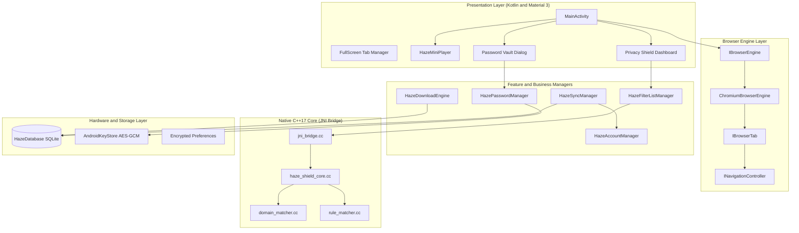

<div align="center">

  

  # Haze Browser

  ### The Ultra-Fast, Minimalist and Privacy-Hardened Web Browser for Android

  <p align="center">
    <b>Engineered with C++17 native filtering, hardware-grade credential encryption, and fluid multitasking.</b>
  </p>

  [](https://www.android.com/)
  [-blue?style=for-the-badge)](https://developer.android.com/)
  [](https://developer.android.com/)
  [](https://kotlinlang.org/)
  [](https://isocpp.org/)
  [](https://cmake.org/)
  [](LICENSE)
  [](LICENSE)

</div>

---

## Table of Contents

- [Overview](#overview)
- [Key Features](#key-features)
  - [Haze Privacy Shield (Native C++17 Core)](#haze-privacy-shield-native-c17-core)
  - [Floating Mini-Player and Picture-in-Picture](#floating-mini-player-and-picture-in-picture)
  - [Hardware-Backed Password Vault](#hardware-backed-password-vault)
  - [Decoupled Browser Engine Architecture](#decoupled-browser-engine-architecture)
  - [Resumable Multi-Threaded Download Engine](#resumable-multi-threaded-download-engine)
  - [Google Account and Cloud Backup Sync](#google-account-and-cloud-backup-sync)
  - [Ambient Themes and Custom Personalization](#ambient-themes-and-custom-personalization)
  - [Power Utilities Suite](#power-utilities-suite)
- [Architecture and Design](#architecture-and-design)
- [Project Directory Structure](#project-directory-structure)
- [Tech Stack and Dependencies](#tech-stack-and-dependencies)
- [Getting Started and Build Instructions](#getting-started-and-build-instructions)
  - [Prerequisites](#prerequisites)
  - [Clone and Build](#clone-and-build)
  - [Running Tests](#running-tests)
- [Privacy and Security Blueprint](#privacy-and-security-blueprint)
- [Roadmap](#roadmap)
- [Intellectual Property and Legal Restrictions](#intellectual-property-and-legal-restrictions)
- [Author and Contact](#author-and-contact)
- [Copyright and Licensing](#copyright-and-licensing)

---

## Overview

**Haze** is a modern, high-performance Android web browser built from the ground up to solve a persistent dilemma: mobile browsers are either loaded with ad-tech bloat and tracking telemetry, or are barren shells lacking essential power-user tooling.

Haze bridges this gap with an uncompromising philosophy:
- **Radical Privacy**: Zero first-party tracking telemetry, zero analytics harvesting, and hardware-grade credential protection.
- **Native Execution**: Heavy-duty ad, tracker, and malware rule-matching compiled into a native C++17 library (`libhaze_native.so`) running over JNI for sub-millisecond request interception.
- **Fluid Ergonomics**: True one-handed mobile navigation, floating video mini-players with edge-snapping physics, customizable ambient themes, and instant tab switching.

---

## Key Features

### Haze Privacy Shield (Native C++17 Core)
The Haze Privacy Shield is a multi-tier defense system designed to block web pollution before network packets consume memory or cellular data.

- **Native C++ Interception**: Utilizes `HazeShieldCore`, `DomainMatcher`, and `RuleMatcher` written in modern C++17 with `std::shared_mutex` for lock-free read concurrency.
- **Sub-Millisecond Evaluation**: An in-memory bounded LRU decision cache (1,024 entries) delivers O(1) decision times on repeated resource lookups.
- **Comprehensive Threat Filtering**:
  - Block intrusive advertising networks, banners, and popups.
  - Neutralize third-party behavioral trackers and fingerprinting scripts (Google Analytics, Facebook Pixel, Hotjar, Clarity).
  - Intercept phishing URLs and malicious domains.
  - Safe Browsing integration via Android WebView engine alerts.
- **Smarter YouTube Shielding**: Intelligently suppresses YouTube ad injections and telemetry pings without degrading legitimate media stream segments (`googlevideo.com`).
- **Live Shield Dashboard**: Transparent, real-time metrics showing total blocked threats, cumulative bandwidth saved (KB/MB/GB), time saved in page render delay, and domain whitelisting controls.

```
                      ┌────────────────────────────────┐
                      │  Web Resource Network Request  │
                      └───────────────┬────────────────┘
                                      │
                         [Is Request Whitelisted?]
                                ├── Yes ──> [ Allow Network Traffic ]
                                └── No
                                      │
                         [In-Memory LRU Decision Cache]
                                ├── Hit ──> [ Return Cached Decision ]
                                └── Miss
                                      │
                         [HazeNativeBridge (JNI)]
                                      │
                         [C++17 HazeShieldCore]
                   ┌──────────────────┼──────────────────┐
                   ▼                  ▼                  ▼
             DomainMatcher      RuleMatcher      Safe Browsing
             (Fast HashSet)   (Pattern Wildcard) (Threat DB)
                   └──────────────────┬──────────────────┘
                                      │
                      ┌───────────────┴────────────────┐
                      │    Block Verdict & Intercept   │
                      │  (Returns 1x1 PNG / 403 No-op) │
                      └────────────────────────────────┘
```

---

### Floating Mini-Player and Picture-in-Picture
Haze turns video consumption on mobile into a multitasking breeze.

- **In-App Floating Mini-Player**:
  - Drag-and-drop floating player over any webpage.
  - Responsive edge-snapping physics and corner minimization.
  - Integrated seek bar, volume mute toggle, and forward/rewind controls.
  - Pinch-and-drag resize handle for flexible scaling.
- **System-Level Picture-in-Picture (PiP)**:
  - Seamlessly transitions into native Android Picture-in-Picture when minimizing the app during video playback.
  - Full Android `MediaSession` integration with lock screen and notification action controls.

---

### Hardware-Backed Password Vault
Never compromise between convenience and security.

- **AndroidKeyStore Security**: Credentials are encrypted using hardware-backed **AES-256-GCM** encryption (`HazePasswordVault`) with secure IV generation.
- **Biometric / Keyguard Gating**: Viewing or exporting passwords requires device authentication (Fingerprint, Face Unlock, or Device PIN).
- **In-Page Credential Autofill and Save**: Detects login submissions and prompts to securely save or update stored credentials.
- **Universal Portability**: Instant CSV import and export compatible with Chrome, Bitwarden, Firefox, and 1Password.

---

### Decoupled Browser Engine Architecture
Built upon clean architectural boundaries, separating UI orchestration from web rendering:

- **Modular Interfaces**: `IBrowserEngine`, `IBrowserTab`, `INavigationController`, and `IEngineObserver` allow underlying engine swapability and mock testing.
- **Chromium Runtime**: Powered by the hardened Android Chromium WebView engine with customized settings.
- **Sandboxed InPrivate Mode**:
  - Ephemeral session memory.
  - Dedicated private tab instances with separate cookie jars and isolated WebStorage.
  - Zero history, zero cache persistence, and instant memory wipe on exit.

---

### Resumable Multi-Threaded Download Engine
A robust download engine engineered for unstable mobile connections:

- **Parallel Worker Pool**: Concurrency-controlled task queue (up to 3 simultaneous downloads).
- **HTTP Range Resume**: Utilizes `RandomAccessFile` and HTTP `Range` headers to resume interrupted downloads without losing progress.
- **Real-Time Telemetry**: Real-time download throughput (KB/s, MB/s), ETA computation, and progress updates.
- **Persistent Queue**: SQLite-backed history tracking file paths, MIME types, and download status.

---

### Google Account and Cloud Backup Sync
Keep your browser data synchronized across your Android ecosystem:

- **Google Sign-In**: Easy authentication via Google Play Services Auth (`play-services-auth`).
- **Selective Data Sync**:
  - Bookmarks and hierarchical folder trees.
  - Custom browser settings and search preferences.
  - Homepage shortcuts and quick links.
  - Color themes and wallpaper selections.
- **Conflict-Free Local/Cloud Merge**: Timestamp-audited JSON sync backups with automatic backup restore.

---

### Ambient Themes and Custom Personalization
Make your browsing canvas uniquely yours:

- **Ambient Wallpapers**: Built-in curated background themes including:
  - *Serene Canyon Arch at Sunset*
  - *Twilight Forest River Valley*
  - *Sunlit Ocean Canyon Reef*
  - *Pastel Ringed Planet Over Dreamy Alien Sea*
  - *Twilight Coastal Road Overlook*
- **Offline Astronaut Experience**: Custom-illustrated interactive offline screen (*Offline Astronaut and Cat on the Moon*) featuring real-time connection diagnostics and a quick retry engine.
- **Dynamic Theming**: Full support for true OLED Dark Mode, crisp Light Mode, and Material Design accent tinting.

---

### Power Utilities Suite
- **Text-to-Speech (TTS) Narrator**: Integrated Web Speech engine to read articles and text content hands-free.
- **QR Code Engine**: Scan web QR codes with the camera and generate QR codes for any webpage link instantly.
- **Universal Omnibox**: Quick-switch search engines on the fly (Google, DuckDuckGo, Bing, Yahoo, Ecosia) with integrated voice search.
- **Responsive Tab Grid**: Visual tab switcher with swipe-to-close gestures, tab count badges, and one-tap restore.
- **Desktop Mode and Immersive View**: Instant desktop User-Agent spoofing and fullscreen distraction-free reading.

---

## Architecture and Design



---

## Project Directory Structure

```text
Haze/
├── .github/                       # CI/CD Workflows & Issue Templates
├── assets/                        # Design assets, brand logos & wallpapers
│   ├── background/                # Curated ambient themes & offline artwork
│   └── logo.png                   # High-resolution Haze emblem
├── app/
│   ├── build.gradle.kts           # Application build script & dependencies
│   ├── src/
│   │   ├── main/
│   │   │   ├── AndroidManifest.xml
│   │   │   ├── cpp/               # High-performance C++17 Native Engine
│   │   │   │   ├── CMakeLists.txt
│   │   │   │   ├── domain_matcher.cc / .h
│   │   │   │   ├── haze_shield_core.cc / .h
│   │   │   │   ├── jni_bridge.cc
│   │   │   │   └── rule_matcher.cc / .h
│   │   │   ├── java/com/example/haze/
│   │   │   │   ├── engine/        # Browser Engine Abstraction (Chromium)
│   │   │   │   │   ├── IBrowserEngine.kt
│   │   │   │   │   ├── IBrowserTab.kt
│   │   │   │   │   ├── INavigationController.kt
│   │   │   │   │   └── chromium/  # Chromium WebView implementations
│   │   │   │   ├── native_engine/ # JNI Bridge Bindings
│   │   │   │   │   ├── HazeNativeBridge.kt
│   │   │   │   │   └── NativeDecision.kt
│   │   │   │   ├── DefaultShortcuts.kt
│   │   │   │   ├── HazeAccountManager.kt
│   │   │   │   ├── HazeBookmarksManager.kt
│   │   │   │   ├── HazeClearDataManager.kt
│   │   │   │   ├── HazeContentFilter.kt
│   │   │   │   ├── HazeContextMenuManager.kt
│   │   │   │   ├── HazeDatabase.kt
│   │   │   │   ├── HazeDownloadEngine.kt
│   │   │   │   ├── HazeDownloadsManager.kt
│   │   │   │   ├── HazeFaviconManager.kt
│   │   │   │   ├── HazeFilterListManager.kt
│   │   │   │   ├── HazeHistoryManager.kt
│   │   │   │   ├── HazeMiniPlayer.kt
│   │   │   │   ├── HazeOnboardingManager.kt
│   │   │   │   ├── HazePasswordManager.kt
│   │   │   │   ├── HazePrivacyShieldDashboard.kt
│   │   │   │   ├── HazePrivacyShieldEngine.kt
│   │   │   │   ├── HazeSecurityWarningManager.kt
│   │   │   │   ├── HazeSettingsManager.kt
│   │   │   │   ├── HazeSyncManager.kt
│   │   │   │   └── MainActivity.kt
│   │   │   └── res/               # Android layouts, drawables, animations
│   │   └── test/                  # Unit & engine test suites
│   │       └── java/com/example/haze/
│   │           └── HazeProtectionEngineTest.kt
├── gradle/
│   └── libs.versions.toml         # Version catalog
└── build.gradle.kts               # Root build script
```

---

## Tech Stack and Dependencies

| Layer | Technology | Purpose |
| :--- | :--- | :--- |
| **Language** | Kotlin 1.9+ / Java 11 | Application logic, UI controllers, async coroutines |
| **Native Core** | C++17 & CMake 3.22.1 | Ultra-fast rule parsing, sub-millisecond pattern matching |
| **UI Components** | Material 3 & AndroidX | Edge-to-edge screens, bottom sheets, fluid transitions |
| **Rendering** | Hardened Android Chromium | Standards-compliant web execution & HTML5 rendering |
| **Cryptography** | AndroidKeyStore (AES-256-GCM) | Hardware-isolated credential encryption |
| **Cloud Sync** | Google Play Services Auth | OAuth 2.0 account authentication & cloud backups |
| **Persistence** | SQLite3 via OpenHelper | Thread-safe historical, bookmark, and download storage |
| **Testing** | JUnit 4 & Espresso | Unit testing filter rules and UI validation |

---

## Getting Started and Build Instructions

### Prerequisites
Make sure your development machine has the following installed:
1. **JDK 17** or newer.
2. **Android Studio** (Ladybug, Meerkat, or newer) with Android SDK 37.
3. **Android NDK** (version 25+ recommended) and **CMake 3.22.1**.

### Clone and Build

```bash
# 1. Clone the repository for private inspection
git clone https://github.com/aryandas079/Haze.git

# 2. Navigate to the project directory
cd Haze

# 3. Build the Debug APK
./gradlew assembleDebug

# 4. Install onto a connected Android device or emulator
./gradlew installDebug
```

> [!NOTE]
> To enable Google Sign-In with cloud sync during personal development, make sure to add your `google-services.json` file inside the `app/` directory configured with your SHA-1 fingerprint.

### Running Tests

Execute the unit test suite verifying the filter list compilation, ad/tracker detection, and third-party rule handling:

```bash
./gradlew testDebugUnitTest
```

---

## Privacy and Security Blueprint

Haze treats user privacy as a fundamental architectural constraint, not an afterthought:

1. **Zero Tracking Telemetry**: Haze collects no telemetry, no device IDs, no browsing habits, and no usage analytics.
2. **Local-First Processing**: URL matching and shield classifications happen 100% on-device in native memory.
3. **Hardware Key Isolation**: Master keys never leave the secure enclave/TEE of your mobile hardware.
4. **Isolated Private Sessions**: Incognito tabs operate in sandboxed contexts that permanently discard cookies, web caches, and storage blobs upon closure.

---

## Roadmap

- [x] Native C++17 Shield Engine with JNI integration
- [x] Hardware-backed Password Vault with biometric unlock
- [x] In-app Draggable Mini-Player & System PiP
- [x] Multi-threaded resumable download engine
- [x] Google Account Cloud Sync
- [ ] DNS-over-HTTPS (DoH) with NextDNS & Cloudflare presets
- [ ] WebExtension (MV3) experimental compatibility layer
- [ ] Tab Groups and Collections
- [ ] Built-in PDF annotator & offline reader mode

---

## Intellectual Property and Legal Restrictions

This repository, including all source code, software architecture, native C++ engines, algorithms, user interfaces, branding, and graphics, is strictly **Proprietary and Confidential**.

- **Strict Prohibition on Copying and Forking**: You are strictly prohibited from copying, cloning, reproducing, duplicating, mirroring, or creating unauthorized forks of this repository or any portion thereof.
- **Prohibition on Derivative Works**: No individual or entity may create derivative works, rebrand, repackage, decompile, reverse engineer, or extract native binaries (`libhaze_native.so`) or assets without prior express written permission from Aryan Das.
- **Prohibition on Copyright Claims**: Any attempt to assert, file, register, or claim copyright, patent, trademark, or ownership rights over this software or its constituent components is strictly illegal and void.
- **Issues and Inquiries**: Bug reports and vulnerability disclosures may be submitted through GitHub Issues.

---

## Author and Contact

**Haze Browser** is designed, architected, and developed by **Aryan Das**.

- **GitHub**: [@aryandas079](https://github.com/aryandas079)
- **LinkedIn**: [Aryan Das](https://linkedin.com/in/iam-aryandas)
- **Instagram**: [@iam_aryandas](https://instagram.com/iam_aryandas)

---

## Copyright and Licensing

### Proprietary Copyright Notice

```text
Copyright (c) 2026 Aryan Das. All Rights Reserved.
```

### Proprietary License and Legal Warning

**NOTICE TO ALL USERS, DEVELOPERS, AND ENTITIES:**

This software and its associated source code are **NOT** open source and are **NOT** licensed under Apache, MIT, GPL, or any permissive public license. Viewing this repository does not grant any license, right, title, or interest.

```text
LEGAL PROHIBITION ON COPYING, REPRODUCTION, AND RE-DISTRIBUTION

1. PROHIBITION OF COPYING:
   Copying, downloading for reproduction, scraping, duplicating, or replicating any code,
   scripts, native C++ routines, shaders, or visual components of Haze Browser is strictly
   illegal without direct, signed written consent from Aryan Das.

2. PROHIBITION OF CLAIMING COPYRIGHT OR OWNERSHIP:
   It is strictly illegal to claim copyright, co-authorship, ownership, or intellectual property
   rights over this code, design, or brand. The code and all derivative concepts are the
   exclusive property of Aryan Das.

3. PROHIBITION OF COMMERCIAL AND NON-COMMERCIAL DISTRIBUTION:
   No portion of this software may be sold, resold, leased, sublicensed, published, embedded,
   or distributed across any third-party app stores, websites, packages, or code repositories.

4. CIVIL AND CRIMINAL LIABILITY:
   Any infringement, unauthorized reproduction, distribution, or reverse engineering constitutes
   an actionable violation of international copyright conventions (including the Berne Convention
   and WIPO Copyright Treaty) and applicable national intellectual property statutes.
   All infringements will be prosecuted to the maximum legal limit, including claims for statutory
   damages, immediate injunctive relief, legal fee recovery, and criminal referral.
```

For formal inquiries, enterprise licensing requests, or written permissions, contact **Aryan Das** via [GitHub](https://github.com/aryandas079) or [LinkedIn](https://linkedin.com/in/iam-aryandas).

---

<div align="center">
  <sub>Copyright (c) 2026 Aryan Das. All Rights Reserved. Proprietary & Confidential.</sub>
</div>
