<div align="center">

  

  # Haze Browser

  ### The Ultra-Fast, Minimalist and Privacy-Hardened Chromium Web Browser for Android

  <p align="center">
    <b>Powered by a custom-compiled dual-ABI Native Chromium Engine (Blink + V8), C++17 native threat filtering, system Notification Media Controller, hybrid local search indexing, and hardware-grade credential encryption.</b>
  </p>

  [](https://www.android.com/)
  [](https://github.com/aryandas079/Haze)
  [-4285F4?style=for-the-badge&logo=googlechrome&logoColor=white)](https://www.chromium.org/)
  [](https://developer.android.com/ndk/guides/abis)
  [-blue?style=for-the-badge)](https://developer.android.com/)
  [](https://developer.android.com/)
  [](https://kotlinlang.org/)
  [](https://isocpp.org/)
  [](https://cmake.org/)
  [](LICENSE)
  [](LICENSE)

</div>

---

## Table of Contents

- [Overview](#overview)
- [Key Features](#key-features)
  - [Custom-Compiled Dual-ABI Native Chromium Engine](#custom-compiled-dual-abi-native-chromium-engine)
  - [Notification Center & Lockscreen Media Controller](#notification-center--lockscreen-media-controller)
  - [Universal Website Compatibility & Streaming Acceleration](#universal-website-compatibility--streaming-acceleration)
  - [Haze Privacy Shield (Native C++17 Core)](#haze-privacy-shield-native-c17-core)
  - [Anti-Tracking, Anti-Fingerprinting & Link Sanitization](#anti-tracking-anti-fingerprinting--link-sanitization)
  - [Hybrid Local Indexing & Live Autocomplete Omnibox](#hybrid-local-indexing--live-autocomplete-omnibox)
  - [Redesigned First-Run Onboarding & Bottom-Anchored UI](#redesigned-first-run-onboarding--bottom-anchored-ui)
  - [Floating Mini-Player and Picture-in-Picture](#floating-mini-player-and-picture-in-picture)
  - [Hardware-Backed Password Vault](#hardware-backed-password-vault)
  - [Resumable Multi-Threaded Download Engine](#resumable-multi-threaded-download-engine)
  - [Google Account and Cloud Backup Sync](#google-account-and-cloud-backup-sync)
  - [Ambient Themes and Custom Personalization](#ambient-themes-and-custom-personalization)
  - [Power Utilities Suite](#power-utilities-suite)
- [Architecture and Design](#architecture-and-design)
- [Project Directory Structure](#project-directory-structure)
- [Tech Stack and Dependencies](#tech-stack-and-dependencies)
- [Getting Started and Build Instructions](#getting-started-and-build-instructions)
  - [Prerequisites](#prerequisites)
  - [Automated Native Binary Reassembly Pipeline](#automated-native-binary-reassembly-pipeline)
  - [Clone and Build](#clone-and-build)
  - [Running Tests](#running-tests)
- [Privacy and Security Blueprint](#privacy-and-security-blueprint)
- [Roadmap](#roadmap)
- [Intellectual Property and Legal Restrictions](#intellectual-property-and-legal-restrictions)
- [Author and Contact](#author-and-contact)
- [Copyright and Licensing](#copyright-and-licensing)

---

## Overview

**Haze** (`com.aryandas.haze`) is a standalone, high-performance Android web browser engineered from the ground up with its own embedded **Native Chromium Engine (`libcontent_shell_content_view.so`)** alongside a dedicated C++17 network and content-filtering core (`libhazeshield.so`).

Unlike lightweight wrapper browsers that rely strictly on the host device's system WebView, Haze ships with a self-contained, custom-compiled Chromium Content runtime supporting both **64-bit (`arm64-v8a`)** and **32-bit (`armeabi-v7a`)** ARM architectures:
- **True Standalone Chromium Runtime**: Ships with compiled Blink rendering, V8 JavaScript snapshots (`snapshot_blob_64.bin` / `snapshot_blob_32.bin`), ICU internationalization data (`icudtl.dat`), Chromium resource packs (`content_shell.pak`), and complete `JNI_Zero` Java-to-C++ runtime bindings (`chromium_engine.jar`).
- **Radical Privacy**: Zero first-party tracking telemetry, zero analytics harvesting, C++17 native ad/tracker interception, and hardware-grade credential protection.
- **System Notification Media Center**: Full foreground Android MediaSession controller integrated directly into the notification shade and lockscreen, providing native playback controls, scrubber tracking, and album artwork across YouTube Music, Spotify, Apple Music, and web streams.
- **Universal Compatibility & 60 FPS Fluidity**: Direct RenderThread hardware composition, native HTTP/2 & HTTP/3 multiplexing, and zero-polling event-driven script architectures delivering stutter-free browsing across complex modern single-page applications.
- **One-Handed Ergonomics**: Chrome-inspired First-Run Experience (FRE), a clean top-toolbar-free viewport with only a contextual profile badge on the Home screen, and all search, tab, voice, and menu actions anchored in a flat bottom bar.

---

## Key Features

### Custom-Compiled Dual-ABI Native Chromium Engine
Haze integrates a full Chromium Content runtime behind a clean, modular engine abstraction (`IBrowserEngine`, `IBrowserTab`, `INavigationController`, `IEngineObserver`):

- **Dual-Architecture Native Binaries**:
  - **64-bit (`arm64-v8a`)** and **32-bit (`armeabi-v7a`)** builds of `libcontent_shell_content_view.so`, packaged into both per-ABI split APKs and a single Universal Release APK (`app-universal-release.apk`) that automatically installs the optimal native binary for the target device.
- **Complete `JNI_Zero` Runtime Bridge**:
  - Bundles 394 compiled Chromium Java archives (15,700+ classes) in `chromium_engine.jar` along with `org.jni_zero.*` runtime dispatchers and runtime resource ID synchronization (`gen.base_module.R` <-> `com.example.haze.R`).
- **Native Tab & Navigation Orchestration (`NativeChromiumTab` / `NativeNavigationController`)**:
  - Multi-tab `WebContents` lifecycle management over `ShellManager` and `ActivityWindowAndroid`.
  - Bidirectional JavaScript bridge (`GinJavaBridgeDispatcherHost` / `@JavascriptInterface`) powering `window.Android` interactions on the New Tab page and web documents.
  - Unrestricted JavaScript evaluation across `https://`, `http://`, and Base64-encoded `data:` origins via `RenderFrameHost` execution bindings.
  - Real-time `WebContentsObserver` callbacks for navigation state, load progress, page titles, error recovery, and canvas-backed tab thumbnail capture.

---

### Notification Center & Lockscreen Media Controller
Haze brings desktop- and dedicated-app-grade media playback controls right to Android's Notification Shade and Lockscreen via `HazeMediaNotificationService`:

- **Native MediaSession Integration**:
  - Full Android `MediaSessionCompat` lifecycle synchronization matching native music apps (Spotify, YouTube Music, Apple Music).
  - Automatically captures and broadcasts live track metadata: Track Title, Artist / Channel, Album, and high-resolution Album Artwork.
- **Notification Shade Playback Controls**:
  - Compact and expanded notification styles (`NotificationCompat.MediaStyle`) featuring Previous Track, Play/Pause toggle, Next Track, and Dismiss controls.
  - Interactive scrub bar and playback position reporting.
- **State Deduplication & Audio Focus Guard**:
  - Automatic state-change deduplication prevents AVRCP churn and audio focus storms, eliminating audio stuttering and main thread hitching.
  - Foreground service lifecycle management compliant with Android 8.0+ through Android 14+ requirements.

---

### Universal Website Compatibility & Streaming Acceleration
Engineered and verified against the top 50 global web destinations (including search engines, streaming giants, social media networks, AI assistants, and enterprise SaaS):

- **Zero-Lag Audio & Video Streaming**:
  - Native RFC 7234 HTTP caching and byte-range streaming (`Range: bytes=...`) delegated directly to Chromium's native C++ network stack, bypassing slow synchronous Java disk layers.
  - Uncompromised support for HLS (`.m3u8`, `.ts`), DASH (`.mpd`, `.m4s`), MP4, WebM, and protected media playback.
- **Event-Driven Media Supervisor**:
  - Replaced high-frequency interval polling (`setInterval`) and repetitive DOM scans with purely event-driven HTML5 media observers (`play`, `playing`, `loadedmetadata`, `loadstart`, `yt-navigate-finish`).
  - RequestAnimationFrame-throttled ad killer and video lifecycle handlers eliminate CPU micro-stutters during 60 FPS video and audio playback.
- **Dynamic Viewport & Client Hints Adaptation**:
  - Automatically supplies correct client hints (`navigator.userAgentData`, `navigator.platform = 'Win32'`) and viewport definitions to ensure proper responsive or desktop layouts on complex modern SPAs (YouTube, Spotify, Discord, Instagram, Canva, Microsoft 365).
- **Direct RenderThread Compositing**:
  - Layer type set to `View.LAYER_TYPE_NONE` with disabled `offscreenPreRaster` prevents redundant intermediate offscreen texture allocations, guaranteeing buttery smooth touch response and scrolling.

---

### Haze Privacy Shield (Native C++17 Core)
The Haze Privacy Shield is a multi-tier defense system designed to block web pollution before network packets consume memory or cellular data.

- **Native C++ Interception**: Utilizes `HazeShieldCore`, `DomainMatcher`, and `RuleMatcher` written in modern C++17 (`libhazeshield.so`) compiled with `-O3 -DNDEBUG -fvisibility=hidden` and `std::shared_mutex` for lock-free read concurrency.
- **Sub-Millisecond Evaluation**: An in-memory bounded LRU decision cache (1,024 entries) delivers O(1) decision times on repeated resource lookups.
- **Declarative CSS Cosmetic Filtering**:
  - Banners, sponsored sections, and ad wrappers are instantly collapsed using declarative CSS rules (`display: none !important`) processed directly inside Blink's C++ styling engine with zero JavaScript overhead.
- **Comprehensive Threat Filtering**:
  - Blocks intrusive advertising networks, tracking beacons, and deceptive notification prompts.
  - Neutralizes third-party behavioral trackers and telemetry scripts (Google Analytics, Facebook Pixel, Hotjar, Clarity).
  - Intercepts phishing URLs and malicious domains with custom security warning pages.
- **Smarter YouTube Shielding**: Intelligently suppresses YouTube ad injections and telemetry pings without degrading legitimate media stream segments (`googlevideo.com`).
- **Debounced Live Shield Dashboard**: Transparent metrics showing total blocked threats, cumulative bandwidth saved, and per-domain whitelisting controls with debounced UI updates that never stall page loading.

```text
                      ┌────────────────────────────────┐
                      │  Web Resource Network Request  │
                      └───────────────┬────────────────┘
                                      │
                         [Is Request Whitelisted?]
                                ├── Yes ──> [ Allow Network Traffic ]
                                └── No
                                      │
                         [In-Memory LRU Decision Cache]
                                ├── Hit ──> [ Return Cached Decision ]
                                └── Miss
                                      │
                         [HazeNativeBridge (JNI)]
                                      │
                         [C++17 HazeShieldCore]
                   ┌──────────────────┼──────────────────┐
                   ▼                  ▼                  ▼
             DomainMatcher      RuleMatcher      Harmful Navigation
             (Fast HashSet)   (Pattern Wildcard)  (Security Gate)
                   └──────────────────┬──────────────────┘
                                      │
                      ┌───────────────┴────────────────┐
                      │    Block Verdict & Intercept   │
                      │  (Cosmetic Hide / Warning UI)  │
                      └────────────────────────────────┘
```

---

### Anti-Tracking, Anti-Fingerprinting & Link Sanitization
Advanced privacy engine (`HazeAntiTrackingEngine`) actively neutralizing silent identity profiling:

- **Fingerprint Defense**:
  - Canvas & WebGL probe detection and masking without corrupting standard image processing, CAPTCHAs, or QR decoders.
  - Audio and font metric measurement probe normalization.
  - Device metric spoofing (`hardwareConcurrency`, `deviceMemory`, `maxTouchPoints`).
- **Bounce Tracking Protection**:
  - Detects and unravels redirect trampoline URLs, bypassing tracking redirectors directly to destination pages.
- **Link Tracking Sanitization**:
  - Strips attribution query parameters (`utm_*`, `fbclid`, `gclid`, `msclkid`, `twclid`, `ttclid`, `mc_eid`, etc.) on navigation and hyperlink taps.
- **WebRTC IP Leak Defense**:
  - Sanitizes local LAN IPv4 candidates from SDP offers while preserving STUN and TURN connectivity for seamless Google Meet, Zoom, and Discord calls.

---

### Hybrid Local Indexing & Live Autocomplete Omnibox
Haze features an instant, low-latency search and indexing pipeline built directly into the bottom omnibox:

- **On-Device Local Index (`buildLocalIndexedSuggestions`)**:
  - Queries and ranks matches across **Recent Searches**, **Custom Homepage Shortcuts**, **Saved Bookmarks** (titles and URLs), and **Browsing History** (`HazeDatabase` SQLite index) as you type.
- **Live Autocomplete Fusion**:
  - Merges deduplicated local index hits with live Google autocomplete suggestions over a debounced asynchronous pipeline (150ms typing debounce with request sequence cancellation).
- **Smart URL vs. Query Resolution**:
  - Automatically distinguishes between direct domain/URL navigation (`https://`, `http://`, TLD detection) and search queries across user-selectable search engines (Google, DuckDuckGo, Bing, Yahoo, Ecosia, Wikipedia).

---

### Redesigned First-Run Onboarding & Bottom-Anchored UI
- **Chrome-Inspired First-Run Experience (`HazeOnboardingManager`)**:
  - Clean, minimalist first-launch welcome flow featuring the Haze emblem, one-tap Google Account sign-in or instant guest continuation, and a streamlined default-browser prompt.
- **Distraction-Free Viewport**:
  - Removes top browser chrome and debug toolbars (`R.id.toolbar` hidden), leaving only a subtle top-right profile avatar on the Home screen and 100% of vertical screen real estate for web content.
- **Bottom-Anchored Navigation Pill**:
  - Houses the omnibox search/address bar, voice search trigger, live tab counter badge, and browser menu within effortless thumb reach, paired with a contextual floating Back/Forward/Share pill on web pages.

---

### Floating Mini-Player and Picture-in-Picture
Haze turns video consumption on mobile into a multitasking breeze.

- **In-App Floating Mini-Player**:
  - Drag-and-drop floating player over any webpage.
  - Responsive edge-snapping physics and corner minimization.
  - Integrated seek bar, volume mute toggle, and forward/rewind controls.
  - Pinch-and-drag resize handle for flexible scaling.

---

### Hardware-Backed Password Vault
Never compromise between convenience and security.

- **AndroidKeyStore Security**: Credentials are encrypted using hardware-backed **AES-256-GCM** encryption (`HazePasswordVault`) with secure IV generation.
- **Biometric / Keyguard Gating**: Viewing or exporting passwords requires device authentication (Fingerprint, Face Unlock, or Device PIN).
- **In-Page Credential Autofill and Save**: Detects login submissions and prompts to securely save or update stored credentials.
- **Universal Portability**: Instant CSV import and export compatible with Chrome, Bitwarden, Firefox, and 1Password.

---

### Resumable Multi-Threaded Download Engine
A robust download engine engineered for unstable mobile connections:

- **Parallel Worker Pool**: Concurrency-controlled task queue (up to 3 simultaneous downloads).
- **HTTP Range Resume**: Utilizes `RandomAccessFile` and HTTP `Range` headers to resume interrupted downloads without losing progress.
- **Real-Time Telemetry**: Real-time download throughput (KB/s, MB/s), ETA computation, and progress updates.
- **Persistent Queue**: SQLite-backed history tracking file paths, MIME types, and download status.

---

### Google Account and Cloud Backup Sync
Keep your browser data synchronized across your Android ecosystem:

- **Google Sign-In**: Easy authentication via Google Play Services Auth (`play-services-auth`).
- **Selective Data Sync**:
  - Bookmarks and hierarchical folder trees.
  - Custom browser settings and search preferences.
  - Homepage shortcuts and quick links.
  - Color themes and wallpaper selections.
- **Conflict-Free Local/Cloud Merge**: Timestamp-audited JSON sync backups with automatic backup restore.

---

### Ambient Themes and Custom Personalization
Make your browsing canvas uniquely yours:

- **Ambient Wallpapers**: Built-in curated background themes including:
  - Serene Canyon Arch at Sunset
  - Twilight Forest River Valley
  - Sunlit Ocean Canyon Reef
  - Pastel Ringed Planet Over Dreamy Alien Sea
  - Twilight Coastal Road Overlook
- **Offline Astronaut Experience**: Custom-illustrated interactive offline screen (Offline Astronaut and Cat on the Moon) featuring real-time connection diagnostics and a quick retry engine.
- **Dynamic Theming**: Full support for true OLED Dark Mode, crisp Light Mode, and Material Design accent tinting.

---

### Power Utilities Suite
- **Text-to-Speech (TTS) Narrator**: Integrated speech synthesis engine to read articles and web page content hands-free.
- **QR Code Engine**: Scan web QR codes with the camera and generate QR codes for any webpage link instantly.
- **In-Page Find (`findAllAsync` / `findNext`)**: Live text highlighting and match cycling across web documents.
- **Responsive Tab Grid**: Full-screen visual tab switcher with live captured tab previews, Normal/Private tab segmentation, and one-tap restore.
- **Desktop Mode and Immersive View**: Instant desktop User-Agent spoofing and fullscreen distraction-free reading.

---

## Architecture and Design

```mermaid
graph TD
    subgraph UI ["Presentation Layer (Kotlin & Material 3)"]
        MA[MainActivity]
        Onboard[HazeOnboardingManager]
        TabMgr[FullScreen Tab Manager]
        MiniPlayer[HazeMiniPlayer]
        ShieldUI[Privacy Shield Dashboard]
        VaultUI[Password Vault Dialog]
        MediaNotif[HazeMediaNotificationService]
    end

    subgraph Core ["Feature & Indexing Managers"]
        SearchIdx[Hybrid Local & Live Search Indexer]
        AccountMgr[HazeAccountManager]
        SyncMgr[HazeSyncManager]
        DownloadEng[HazeDownloadEngine]
        PassVault[HazePasswordManager]
        FilterMgr[HazeFilterListManager]
        AntiTrack[HazeAntiTrackingEngine]
    end

    subgraph Abstraction ["Decoupled Browser Engine Layer"]
        IBEngine[IBrowserEngine]
        IBTab[IBrowserTab]
        INav[INavigationController]
        NativeEngine[NativeChromiumBrowserEngine]
        NativeTab[NativeChromiumTab]
        NativeNav[NativeNavigationController]
        ChromiumTab[ChromiumBrowserTab]
    end

    subgraph ChromiumNative ["Embedded Chromium Runtime (arm64-v8a & armeabi-v7a)"]
        JniZero[JNI_Zero Bridge & chromium_engine.jar]
        ContentShell[libcontent_shell_content_view.so]
        BlinkV8[Blink Renderer + V8 Snapshot + ICU Data]
    end

    subgraph ShieldNative ["Native C++17 Shield Core (libhazeshield.so)"]
        JNI[jni_bridge.cc]
        ShieldCore[haze_shield_core.cc]
        DomainMatch[domain_matcher.cc]
        RuleMatch[rule_matcher.cc]
    end

    subgraph SystemServices ["Android System Integration"]
        MediaSession[Android MediaSessionCompat]
        NotifManager[NotificationManager & Shade]
        KeyStore[AndroidKeyStore AES-GCM]
        DB[(HazeDatabase SQLite)]
    end

    MA --> Onboard
    MA --> SearchIdx
    SearchIdx --> DB
    MA --> IBEngine
    IBEngine --> NativeEngine
    NativeEngine --> NativeTab
    NativeTab --> NativeNav
    NativeEngine --> JniZero
    JniZero --> ContentShell
    ContentShell --> BlinkV8

    MA --> ChromiumTab
    ChromiumTab --> MediaNotif
    MediaNotif --> MediaSession
    MediaNotif --> NotifManager

    MA --> MiniPlayer
    MA --> ShieldUI
    MA --> VaultUI

    ShieldUI --> FilterMgr
    FilterMgr --> JNI
    JNI --> ShieldCore
    ShieldCore --> DomainMatch
    ShieldCore --> RuleMatch
    ChromiumTab --> AntiTrack

    VaultUI --> PassVault
    PassVault --> KeyStore

    SyncMgr --> AccountMgr
    SyncMgr --> DB
    DownloadEng --> DB
```



---

## Project Directory Structure

```text
Haze/
├── .github/                              # CI/CD Workflows & Issue Templates
├── assets/                               # Brand logos & design showcases
│   ├── background/                       # Curated ambient themes & offline artwork
│   └── logo.png                          # High-resolution Haze emblem
├── app/
│   ├── build.gradle.kts                  # Build config (com.aryandas.haze), ABI splits, R8 & native unpacker
│   ├── google-services.json              # Firebase & Google Services client credentials
│   ├── proguard-rules.pro                # R8 keep rules for JNI_Zero, Chromium & AndroidX bridges
│   ├── libs/                             # Compiled Chromium Java runtime archives
│   │   ├── chromium_engine.jar           # Merged 394 Chromium Content/Blink/Base Java libraries
│   │   ├── media_java.jar                # Chromium media & audio bindings
│   │   └── ...                           # Mojo, capture, gamepad, bluetooth & GURL jars
│   ├── native_blobs/                     # GitHub-safe (<40MB) compressed Chromium .so chunks
│   │   ├── arm64-v8a/                    # 64-bit libcontent_shell_content_view.so.gz.part00..02
│   │   └── armeabi-v7a/                  # 32-bit libcontent_shell_content_view.so.gz.part00..01
│   ├── src/
│   │   ├── main/
│   │   │   ├── AndroidManifest.xml       # Permissions, FileProvider authority & MediaPlayback service
│   │   │   ├── assets/                   # Chromium & Haze runtime assets
│   │   │   │   ├── content_shell.pak     # Chromium UI & Blink packed resources
│   │   │   │   ├── icudtl.dat            # ICU internationalization data table
│   │   │   │   ├── snapshot_blob_64.bin  # 64-bit V8 heap & context startup snapshot
│   │   │   │   ├── snapshot_blob_32.bin  # 32-bit V8 heap & context startup snapshot
│   │   │   │   └── ...                   # Ambient WebP wallpapers & filter rules
│   │   │   ├── cpp/                      # C++17 Native Privacy Shield (libhazeshield.so)
│   │   │   │   ├── CMakeLists.txt
│   │   │   │   ├── domain_matcher.cc / .h
│   │   │   │   ├── haze_shield_core.cc / .h
│   │   │   │   ├── jni_bridge.cc
│   │   │   │   └── rule_matcher.cc / .h
│   │   │   ├── jniLibs/                  # Reassembled native Chromium libraries (auto-unpacked)
│   │   │   │   ├── arm64-v8a/libcontent_shell_content_view.so
│   │   │   │   └── armeabi-v7a/libcontent_shell_content_view.so
│   │   │   ├── java/
│   │   │   │   ├── org/jni_zero/         # JNI_Zero native dispatch & annotation bindings
│   │   │   │   └── com/example/haze/
│   │   │   │       ├── engine/           # Browser Engine Abstraction & Implementations
│   │   │   │       │   ├── IBrowserEngine.kt
│   │   │   │       │   ├── IBrowserTab.kt
│   │   │   │       │   ├── INavigationController.kt
│   │   │   │       │   ├── chromium/       # Optimized Chromium tab with MediaSession & AdGuard rules
│   │   │   │       │   └── nativechromium/ # Embedded Native Chromium Content runtime
│   │   │   │       │       ├── NativeChromiumBrowserEngine.kt
│   │   │   │       │       ├── NativeChromiumTab.kt
│   │   │   │       │       └── NativeNavigationController.kt
│   │   │   │       ├── native_engine/    # C++17 Privacy Shield JNI Bridge
│   │   │   │       ├── HazeMediaNotificationService.kt # Foreground Notification Center Media Controller
│   │   │   │       ├── HazeAntiTrackingEngine.kt       # Anti-Fingerprinting & Link Sanitizer
│   │   │   │       └── MainActivity.kt   # Primary browser orchestrator & hybrid indexer
│   │   │   └── res/                      # Android layouts, icons, and themes
│   │   └── test/                         # Unit & engine test suites
│   └── src/androidTest/                  # Instrumentation test suite (com.aryandas.haze)
├── gradle/
│   └── libs.versions.toml                # Version catalog
└── build.gradle.kts                      # Root build script
```

---

## Tech Stack and Dependencies

| Layer | Technology | Purpose |
| :--- | :--- | :--- |
| **Application ID** | `com.aryandas.haze` | Official package identity across Android OS and distribution channels |
| **Language** | Kotlin 1.9+ / Java 11 | Application logic, UI controllers, engine orchestration |
| **Web Engine** | Custom Native Chromium (`arm64-v8a` & `armeabi-v7a`) | Standalone Blink rendering, V8 JS engine, `WebContents` & `JNI_Zero` |
| **Native Shield** | C++17 & CMake 3.22.1 (`libhazeshield.so`) | Ultra-fast rule parsing, sub-millisecond ad/tracker pattern matching |
| **Media Controller** | `MediaSessionCompat` & Foreground Service | Notification shade and lockscreen playback controls with scrubber tracking |
| **Build Optimization** | R8 Minification, Resource Shrinking & C++ `-O3` Strip | Bytecode tree-shaking, symbol stripping, per-ABI & Universal APK packaging |
| **UI Components** | Material 3 & AndroidX | Edge-to-edge screens, bottom-anchored omnibox, fluid transitions |
| **Cryptography** | AndroidKeyStore (AES-256-GCM) | Hardware-isolated credential encryption |
| **Cloud Sync** | Google Play Services Auth | OAuth 2.0 account authentication & cloud backups |
| **Persistence** | SQLite3 (`HazeDatabase`) | Thread-safe history, bookmark, shortcut, and download indexing |

---

## Getting Started and Build Instructions

### Prerequisites
Make sure your development machine has the following installed:
1. **JDK 17** or newer (Android Studio bundled JBR recommended).
2. **Android Studio** (Ladybug, Meerkat, or newer) with **Android SDK 37**.
3. **Android NDK** (version 25+ / 28+) and **CMake 3.22.1**.

### Automated Native Binary Reassembly Pipeline
Because GitHub enforces a strict 100 MB per-file limit, the compiled 64-bit (`arm64-v8a`, ~292 MB) and 32-bit (`armeabi-v7a`, ~138 MB) `libcontent_shell_content_view.so` binaries are stored in the repository as compressed `<= 40 MB` chunks under `app/native_blobs/<abi>/`.

When you run any Gradle build task, the custom **`prepareNativeChromiumLibs`** task (hooked automatically into `preBuild` in `app/build.gradle.kts`) seamlessly concatenates and decompresses both `.so` binaries into `app/src/main/jniLibs/arm64-v8a/` and `app/src/main/jniLibs/armeabi-v7a/` before packaging.

### Clone and Build

```bash
# 1. Clone the repository
git clone https://github.com/aryandas079/Haze.git

# 2. Navigate to the project directory
cd Haze

# 3. Build the optimized Release APKs (Universal + arm64-v8a + armeabi-v7a)
./gradlew assembleRelease

# 4. Install the Universal Release APK onto any 32-bit or 64-bit Android device
adb install -r app/build/outputs/apk/release/app-universal-release.apk
```

The release build generates three APKs under `app/build/outputs/apk/release/`:
- `app-universal-release.apk`: Universal APK containing both `arm64-v8a` and `armeabi-v7a` native engines (works on all Android phones).
- `app-arm64-v8a-release.apk`: Dedicated 64-bit ARM release APK.
- `app-armeabi-v7a-release.apk`: Dedicated 32-bit ARM release APK.

> [!NOTE]
> To enable Google Sign-In with cloud sync during personal development, make sure your `google-services.json` file inside the `app/` directory is configured with your signing key's SHA-1 fingerprint for package `com.aryandas.haze`.

### Running Tests

Execute the unit test suite verifying filter list compilation, ad/tracker detection, and third-party rule handling:

```bash
./gradlew testDebugUnitTest
```

---

## Privacy and Security Blueprint

Haze treats user privacy as a fundamental architectural constraint, not an afterthought:

1. **Zero Tracking Telemetry**: Haze collects no telemetry, no device IDs, no browsing habits, and no usage analytics.
2. **Local-First Processing**: URL matching, search indexing, and shield classifications happen 100% on-device in native and local SQLite memory.
3. **Hardware Key Isolation**: Master keys never leave the secure enclave/TEE of your mobile hardware.
4. **Isolated Private Sessions**: Incognito tabs operate in isolated contexts that permanently discard cookies, web caches, and storage blobs upon closure.
5. **Surrogate Scripting**: Blocks invasive analytics and advertising trackers while safely supplying lightweight local surrogate stubs (`gtag`, `fbq`, `clarity`, `adsbygoogle`) to ensure host websites never break.

---

## Roadmap

- [x] Production application identity migration to `com.aryandas.haze`
- [x] Custom-compiled Dual-ABI (`arm64-v8a` & `armeabi-v7a`) Native Chromium Engine integration
- [x] Full `JNI_Zero` runtime bridge & `chromium_engine.jar` packaging
- [x] Android Notification Center & Lockscreen Media Controller with scrubber controls
- [x] Zero-polling streaming media acceleration for YouTube Music, Spotify, and web video
- [x] Event-driven ad mitigation and declarative CSS cosmetic filtering
- [x] Chrome-inspired First-Run Experience & bottom-anchored UI redesign
- [x] Hybrid local database indexing + live Google autocomplete search omnibox
- [x] Native C++17 Shield Engine (`libhazeshield.so`) with JNI integration
- [x] Anti-Fingerprinting, Bounce Tracking protection, and link parameter sanitizer
- [x] Hardware-backed Password Vault with biometric unlock
- [x] In-app Draggable Mini-Player
- [x] Multi-threaded resumable download engine
- [x] Google Account Cloud Sync
- [ ] DNS-over-HTTPS (DoH) with NextDNS & Cloudflare presets
- [ ] WebExtension (MV3) experimental compatibility layer
- [ ] Tab Groups and Collections
- [ ] Built-in PDF annotator & offline reader mode

---

## Intellectual Property and Legal Restrictions

This repository, including all source code, software architecture, native C++ engines, custom Chromium integrations, algorithms, user interfaces, branding, and graphics, is strictly **Proprietary and Confidential**.

- **Strict Prohibition on Copying and Forking**: You are strictly prohibited from copying, cloning, reproducing, duplicating, mirroring, or creating unauthorized forks of this repository or any portion thereof.
- **Prohibition on Derivative Works**: No individual or entity may create derivative works, rebrand, repackage, decompile, reverse engineer, or extract native binaries (`libcontent_shell_content_view.so`, `libhazeshield.so`) or assets without prior express written permission from Aryan Das.
- **Prohibition on Copyright Claims**: Any attempt to assert, file, register, or claim copyright, patent, trademark, or ownership rights over this software or its constituent components is strictly illegal and void.
- **Issues and Inquiries**: Bug reports and vulnerability disclosures may be submitted through GitHub Issues.

---

## Author and Contact

**Haze Browser** is designed, architected, and developed by **Aryan Das**.

- **GitHub**: [@aryandas079](https://github.com/aryandas079)
- **LinkedIn**: [Aryan Das](https://linkedin.com/in/iam-aryandas)
- **Instagram**: [@iam_aryandas](https://instagram.com/iam_aryandas)

---

## Copyright and Licensing

### Proprietary Copyright Notice

```text
Copyright (c) 2026 Aryan Das. All Rights Reserved.
```

### Proprietary License and Legal Warning

**NOTICE TO ALL USERS, DEVELOPERS, AND ENTITIES:**

This software and its associated source code are **NOT** open source and are **NOT** licensed under Apache, MIT, GPL, or any permissive public license. Viewing this repository does not grant any license, right, title, or interest.

```text
LEGAL PROHIBITION ON COPYING, REPRODUCTION, AND RE-DISTRIBUTION

1. PROHIBITION OF COPYING:
   Copying, downloading for reproduction, scraping, duplicating, or replicating any code,
   scripts, native C++ routines, shaders, or visual components of Haze Browser is strictly
   illegal without direct, signed written consent from Aryan Das.

2. PROHIBITION OF CLAIMING COPYRIGHT OR OWNERSHIP:
   It is strictly illegal to claim copyright, co-authorship, ownership, or intellectual property
   rights over this code, design, or brand. The code and all derivative concepts are the
   exclusive property of Aryan Das.

3. PROHIBITION OF COMMERCIAL AND NON-COMMERCIAL DISTRIBUTION:
   No portion of this software may be sold, resold, leased, sublicensed, published, embedded,
   or distributed across any third-party app stores, websites, packages, or code repositories.

4. CIVIL AND CRIMINAL LIABILITY:
   Any infringement, unauthorized reproduction, distribution, or reverse engineering constitutes
   an actionable violation of international copyright conventions (including the Berne Convention
   and WIPO Copyright Treaty) and applicable national intellectual property statutes.
   All infringements will be prosecuted to the maximum legal limit, including claims for statutory
   damages, immediate injunctive relief, legal fee recovery, and criminal referral.
```

For formal inquiries, enterprise licensing requests, or written permissions, contact **Aryan Das** via [GitHub](https://github.com/aryandas079) or [LinkedIn](https://linkedin.com/in/iam-aryandas).

---

<div align="center">
  <sub>Copyright (c) 2026 Aryan Das. All Rights Reserved. Proprietary & Confidential.</sub>
</div>
